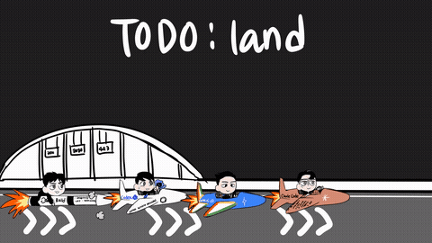

[README.md](https://github.com/user-attachments/files/30971055/README.md)
# animation-meme-rig

Composite hand-drawn PNG parts into looping animation-meme GIFs.



Four characters, four aircraft, 216 frames. Every line was drawn by hand in Clip
Studio Paint. This repo only does the compositing and the timing.

## What it does

You export your character as separate PNG layers sharing one canvas — head, hair,
tie, flame, whatever moves. You then describe each frame as a list of layers with
`dx`, `dy`, `rot`, `pivot`, `scale`, `opacity`. The renderer composites every frame
and writes a transparent looping GIF.

## What it does not do

- It does not generate or alter artwork. You draw; it moves what you drew.
- No skeleton, no IK, no bone weights. Flat 2D layer transforms only.

## Requirements

Python 3.10+, Pillow, numpy. `ffmpeg` optional, for mp4 output.

```
pip install pillow numpy
```

## Quickstart

**1. Check your parts before anything else.**

```
python3 scripts/inspect_parts.py ./parts
```

Reports canvas size, alpha presence, and content bounding box per file. Mismatched
canvas sizes and flattened (opaque) exports are the two mistakes that waste the most
time — catch them here, not after rendering.

**2. Write a spec.**

```json
{
  "base_dir": "./parts",
  "out": "out.gif",
  "height": 620,
  "parts": { "base": "base.png", "hair": "hair.png" },
  "frames": [
    { "ms": 42, "layers": [
      { "part": "base", "dy": 6 },
      { "part": "hair", "rot": 4, "pivot": [920, 175] }
    ]}
  ]
}
```

Layers render back to front, so the first entry is the furthest back.

**3. Render.**

```
python3 scripts/rig_global_palette.py spec.json 50
```

The second argument is the margin in pixels around the auto-computed crop.

**4. Verify by eye. Every time.**

```
python3 scripts/contact_sheet.py out.gif
```

Missing parts, joint gaps, and layer-order mistakes do not show up in coordinates.
They show up when you look at all the frames side by side.

## Pitfalls

Each of these cost a full working session to diagnose. They are most of the reason
this repo exists.

### Per-frame palettes break playback in some decoders

Calling `convert('P', palette=ADAPTIVE)` once per frame gives every frame its own
palette. Combined with `disposal=2`, some decoders — macOS Preview among them — draw
the transitions wrong, and the file looks corrupted on the viewer's machine while
being perfectly fine when you inspect it frame by frame.

The tell is oddly specific: in a 48-frame float cycle, exactly the two frames where
the rotation lands on zero looked correct, and the other 46 did not.

`rig_global_palette.py` builds one palette from all frames and applies it to every
frame. Use it for anything you ship.

### Scale and rotation pivots belong to the part, not the body

If a part's pivot sits far away from the part itself, scaling it becomes translation.
A 10% flame flicker pivoted on the fuselage centre walked the flame off the canvas.

Measure the root from the alpha channel instead of eyeballing it:

```python
a = np.array(im)[..., 3] > 10
ys, xs = np.where(a)
x1 = xs.max()                                   # root on the right edge
root = (x1, int(np.median(ys[xs >= x1 - 15])))
```

### Cover parts do not cover at every angle

Any time one part exists to hide a seam on another — hair over a scalp, a sleeve over
a shoulder, a torso over a hip joint, a vehicle body over its rider — check the cover
holds across the whole cycle, not just the rest pose.

The version that bit us: a smooth head silhouette on the base layer with a separate
hair overlay on top. At some rotations the overlay stopped covering the silhouette,
and that frame alone looked like the character's head had been sliced flat.

Measure it before rendering rather than after someone reports it:

```python
seam = base_alpha & seam_box            # box over the crown
exposed = (seam & ~hair_alpha).sum()    # worst value across all frames
```

Under 5% of the seam area is fine. Above that, adjust the overlay's `dx`/`dy`/`scale`
and reduce the rotation amplitude. Do not fix it by scaling the overlay up until it
covers — that buries silhouette details like antenna hair and reads as a helmet.

### Do not guess the crop

Union the alpha of every frame, take the bounding box, add a margin. The renderer
does this. A crop guessed from one frame will clip a different frame.

## Limitations

Two jobs behind this so far: a crouch-and-stretch sticker loop, and four characters on
aircraft over a scrolling background. Read everything here against that number.

- Tested on chibi proportions with short limbs. Eight-head-tall figures need upper
  and lower arms split at the elbow, and that path is unverified here.
- Parts must share one canvas. That is this renderer's assumption, not a law of
  rigging — per-part crops with anchor coordinates are a valid design, just not this one.
- No parent-transform inheritance. If hair should follow a tilting head, you add the
  head's rotation to the hair's yourself when generating frames.
- GIF out only. mp4 is a separate `ffmpeg` step, not built in.
- Single threaded. 216 frames at 1280x720 takes a couple of minutes.
- No easing helpers yet — frame values are computed in your own script.

## Using this with Claude

`SKILL.md` is a working brief written for Claude rather than for a person. Drop it in
and you can hand over parts and describe the motion in plain language instead of
writing spec files by hand. The scripts work fine on their own if you prefer that.

## License

Code is MIT — see `LICENSE`.

Artwork, characters, and rendered examples are **not** covered by that license and
remain © the author, all rights reserved. No character source parts are included in
this repository.

## Credits

Built with Claude.
