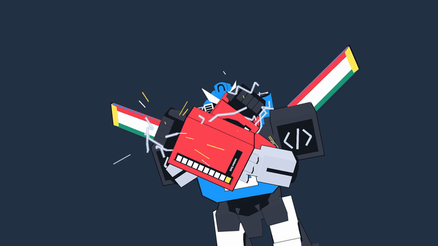
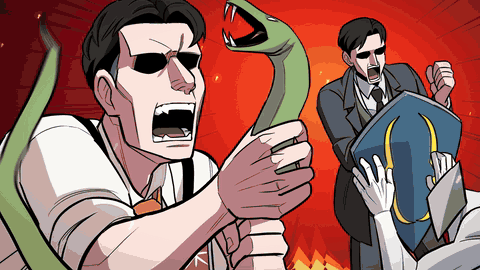

# animation-meme-rig
## Robots, Vehicles & Transformations



A standalone **robot + vehicle transformation** demo: a jet, ship and bike combine into one robot, with six mechanisms and deterministic motion.
The GIF shows the robot's charge, release and run; explore the vehicle modes and transformation in the [Fusion Lab source package](demos/robot_vehicle_transformation/README.md).
Download this repository and open `demos/robot_vehicle_transformation/index.html` in a desktop browser. This demo uses locally bundled Three.js; the hand-drawn animation tools below use Python.

## Hand-drawn animation with Python



**Rig and animate your hand-drawn PNGs with Python. No After Effects.**

▶ Watch the (blockbuster-sized) making-of: [NO AFTER EFFECTS: Why Am I Doing This? (Claude × GPT)](https://youtu.be/7Ok7jbB9xaE)

An AI-agent skill (works with Claude, GPT, or plain Python) that turns supplied drawings into
animation memes, moving emoticons and comic cuts — using code instead of keyframes.
It never draws or redesigns your art: bring your own PNG parts.

## What it can do


- **Mesh warp on a single flattened PNG** – make one layer talk, type, nod, tremble or stretch. No need to cut it into parts.
- **Parent-child rigs** – head, arms, hands follow their parents; contact changes keep the drawing attached
- **Comic timing** – hit-stops, anticipation, overshoot, late reactions, beat-synced pose cuts
- **Punches & effects** – speed lines, layered effects, temporal motion blur
- **Camera** – finite-camera turns, 2.5D floors, globes, folded-room shots, safe framing for unfinished body edges
- **Output** – PNG sequence, GIF (one global palette) or MP4

## Install

| Where | How |
|---|---|
| Claude (web / desktop) | Zip this folder and add it as a custom skill |
| Claude Code | Copy the folder to `~/.claude/skills/animation-meme-rig` |
| Any other agent / plain Python | `pip install -r requirements.txt` and point your agent at `SKILL.md` |

Requirements: Python 3 with NumPy, Pillow and OpenCV (`requirements.txt`); `ffmpeg` for MP4.

## Quick start

```sh
python scripts/render.py --help                     # common renderer + validation
python scripts/render.py scene.json --assets ./art --out preview.gif

# mouth-acting preview on a single flattened PNG
python scripts/render_comic_preview.py --source character.png \
  --profile examples/comic_mouth_profile.json --output mouth_preview.gif
```

Or just tell your agent: *"Read animation-meme-rig and animate these PNGs."*

## Docs

- [`SKILL.md`](SKILL.md) – entry point for agents
- [`references/comic-acting.md`](references/comic-acting.md) – mouth/hand acting, typing, trembles, comic timing recipes
- [`references/spec.md`](references/spec.md) · [`references/primitives.md`](references/primitives.md) · [`references/runtime.md`](references/runtime.md)

Coordinates and timings in the examples are measured on specific drawings, not universal presets — re-measure for your art.

## Tests

```sh
python -m unittest discover -s tests -v   # 132 tests
```

## License

The Python rigging tools use [MIT](LICENSE) – use them, change them, ship them. Keep the copyright notice.
The standalone robot demo has a [separate licensing notice](demos/robot_vehicle_transformation/LICENSE-NOTICE.txt); its bundled Three.js runtime retains its own MIT license.

Made by a webtoon artist, with Claude and GPT doing the typing. → [YouTube](https://www.youtube.com/@The_singularity_is_coming)


